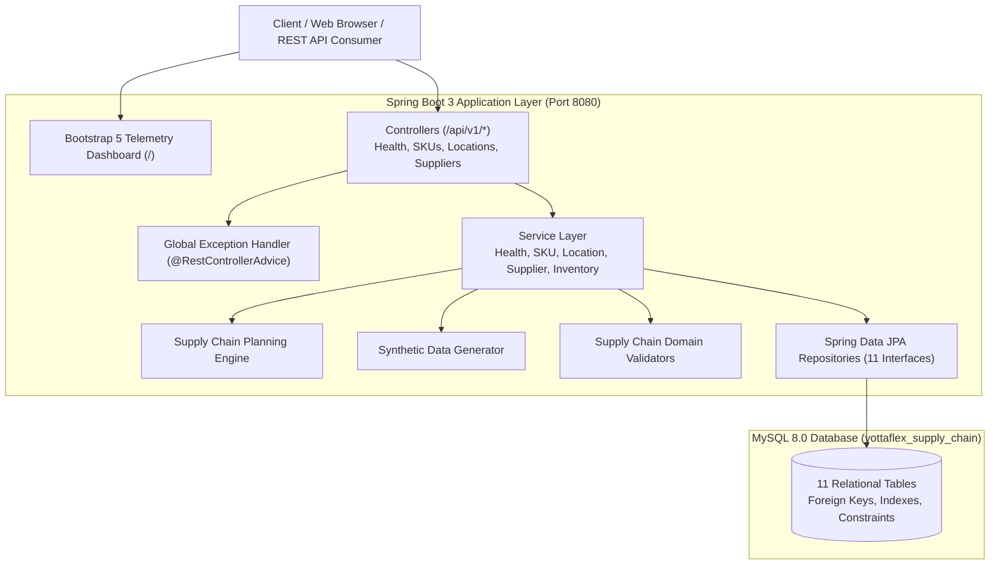

# YottaFlex Supply Chain Planning and Synthetic Data Generation System

[](https://adoptium.net/)
[](https://spring.io/projects/spring-boot)
[](https://www.mysql.com/)
[](https://maven.apache.org/)
[](LICENSE)
[]()

An enterprise-grade supply chain planning, multi-echelon inventory optimization, demand forecasting, and synthetic scenario generation platform engineered with **Java 21**, **Spring Boot 3**, **Hibernate JPA**, and **MySQL 8**.

---

## Table of Contents

1. [Architecture Overview](#architecture-overview)
2. [Technology Stack](#technology-stack)
3. [Domain Models (11 Entities)](#domain-models-11-entities)
4. [Project Structure](#project-structure)
5. [Prerequisites & System Setup](#prerequisites--system-setup)
6. [Environment Configuration](#environment-configuration)
7. [Building & Running the Application](#building--running-the-application)
8. [Database Scripts & Sample Data](#database-scripts--sample-data)
9. [REST API Documentation & Testing](#rest-api-documentation--testing)
10. [Web Telemetry Dashboard](#web-telemetry-dashboard)
11. [Milestone 1 Verification Evidence](#milestone-1-verification-evidence)
12. [AI Governance & Audit Logs](#ai-governance--audit-logs)

---

## Architecture Overview



---

## Technology Stack

- **Runtime & Language:** Java 21 LTS (Eclipse Adoptium OpenJDK 21.0.13)
- **Application Framework:** Spring Boot 3.3.5
- **ORM / Persistence:** Spring Data JPA / Hibernate ORM 6.5.3
- **Database Engine:** MySQL Server 8.0+
- **Build & Dependency Management:** Apache Maven 3.9.9
- **Validation:** Jakarta Bean Validation (Hibernate Validator)
- **Observability:** Spring Boot Actuator
- **Frontend Dashboard:** HTML5, CSS3, Bootstrap 5.3.3, Vanilla JavaScript (ES6+), Bootstrap Icons
- **Testing Suite:** JUnit 5, Mockito, Spring Boot Starter Test (MockMvc & AssertJ)

---

## Domain Models (11 Entities)

The system is architected around 11 core domain entities with JPA relationships and validation rules:

| # | Entity Class | Database Table | Key Attributes & Validations | Relational Mapping |
|---|---|---|---|---|
| 1 | **[`SKU`](file:///d:/supply_chain/src/main/java/com/yottaflex/supplychain/entity/SKU.java)** | `skus` | `skuCode` (UK), `name`, `unitCost`, `sellingPrice`, `reorderPoint`, `safetyStock`, `leadTimeDays` | Parent to Inventory, Demands, POs, Plans |
| 2 | **[`Location`](file:///d:/supply_chain/src/main/java/com/yottaflex/supplychain/entity/Location.java)** | `locations` | `locationCode` (UK), `name`, `type` (`LocationType`), `city`, `country`, `capacity` | Parent to Inventory, Demands, PO Destinations |
| 3 | **[`Supplier`](file:///d:/supply_chain/src/main/java/com/yottaflex/supplychain/entity/Supplier.java)** | `suppliers` | `supplierCode` (UK), `name`, `rating`, `reliabilityScore`, `email` | Parent to POs, Capacities, Lead Times |
| 4 | **[`ForecastDemand`](file:///d:/supply_chain/src/main/java/com/yottaflex/supplychain/entity/ForecastDemand.java)** | `forecast_demands` | `forecastDate`, `periodType`, `forecastQuantity`, `confidenceScore` | Many-to-One with SKU & Location |
| 5 | **[`Inventory`](file:///d:/supply_chain/src/main/java/com/yottaflex/supplychain/entity/Inventory.java)** | `inventories` | `quantityOnHand`, `quantityReserved`, `quantityAvailable`, `status` | Composite Unique `(sku_id, location_id)` |
| 6 | **[`SupplierCapacity`](file:///d:/supply_chain/src/main/java/com/yottaflex/supplychain/entity/SupplierCapacity.java)** | `supplier_capacities` | `dailyCapacity`, `monthlyCapacity`, `allocatedCapacity`, `availableCapacity` | Many-to-One with Supplier & SKU |
| 7 | **[`LeadTime`](file:///d:/supply_chain/src/main/java/com/yottaflex/supplychain/entity/LeadTime.java)** | `lead_times` | `standardDays`, `expeditedDays`, `minimumOrderQuantity`, `transportMode` | Many-to-One with Supplier, SKU & Destination Location |
| 8 | **[`PurchaseOrder`](file:///d:/supply_chain/src/main/java/com/yottaflex/supplychain/entity/PurchaseOrder.java)** | `purchase_orders` | `poNumber` (UK), `orderDate`, `expectedDeliveryDate`, `quantityOrdered`, `unitPrice` | Many-to-One with Supplier, SKU & Location |
| 9 | **[`ProductionPlan`](file:///d:/supply_chain/src/main/java/com/yottaflex/supplychain/entity/ProductionPlan.java)** | `production_plans` | `planCode` (UK), `startDate`, `endDate`, `plannedQuantity`, `producedQuantity` | Many-to-One with SKU & Location |
| 10 | **[`Shortage`](file:///d:/supply_chain/src/main/java/com/yottaflex/supplychain/entity/Shortage.java)** | `shortages` | `shortageCode` (UK), `shortageDate`, `shortageQuantity`, `severity`, `rootCause` | Many-to-One with SKU & Location, One-to-Many MitigationOptions |
| 11 | **[`MitigationOption`](file:///d:/supply_chain/src/main/java/com/yottaflex/supplychain/entity/MitigationOption.java)** | `mitigation_options` | `optionCode` (UK), `strategy`, `costImpact`, `timeImpactDays`, `recommendationScore` | Many-to-One with Shortage, optional Supplier & Location |

---

## Project Structure

```
com.yottaflex.supplychain
├── config                     # Web MVC, CORS, and cross-cutting configurations
├── controller                 # RESTful APIs & Web endpoints (Health, SKUs, Locations, Suppliers)
├── service                    # Core business logic layer & health diagnostics
├── repository                 # Spring Data JPA repositories (11 interfaces)
├── entity                     # Domain models, @MappedSuperclass, and enumerations
├── dto                        # Standardized API response envelopes & error schemas
├── exception                  # Global exception advice & domain runtime exceptions
├── generator                  # Synthetic data scenario generation module
├── validation                 # Supply chain domain constraint validators
├── engine                     # Shortage analysis and planning optimization engine
└── util                       # Financial, date, and math calculation utilities
```

---

## Prerequisites & System Setup

- **Java Development Kit:** JDK 21 LTS installed and set in `JAVA_HOME`.
- **Apache Maven:** 3.8+ (3.9.9 recommended) installed and set in `PATH`.
- **MySQL Database:** MySQL 8.0+ service running locally or reachable via network.

Verify your environment:
```bash
java -version
mvn -version
mysql --version
```

---

## Environment Configuration

Database credentials are **strictly required via environment variables** and are **never hardcoded**. The application provides zero default credentials in configuration files.

Copy the safe environment template:
```bash
cp .env.example .env
```

Configurable variables:
| Variable | Description | Source |
|---|---|---|
| `SPRING_DATASOURCE_USERNAME` | MySQL database username | Environment variable |
| `SPRING_DATASOURCE_PASSWORD` | MySQL database password | Environment variable |
| `SPRING_DATASOURCE_URL` | JDBC connection URL (optional override) | `jdbc:mysql://localhost:3306/yottaflex_supply_chain?createDatabaseIfNotExist=true&useSSL=false&serverTimezone=UTC&allowPublicKeyRetrieval=true` |
| `PORT` | Web application port | `8080` |

### Setting Credentials Privately in Windows PowerShell

To configure credentials securely in your local PowerShell session without displaying, echoing, or logging your password:

```powershell
$env:SPRING_DATASOURCE_USERNAME = Read-Host "Enter MySQL username"
$securePassword = Read-Host "Enter MySQL password" -AsSecureString
$env:SPRING_DATASOURCE_PASSWORD = [System.Net.NetworkCredential]::new("", $securePassword).Password
```

*(Note: `-AsSecureString` masks password characters as asterisks during input, and the decrypted credential resides exclusively in local process memory without being echoed to console or written to shell history).*

---

## Building & Running the Application

### 1. Compile and Run Automated Tests
```bash
mvn clean test
```

### 2. Package the Application
```bash
mvn clean package -DskipTests
```
This produces an executable JAR in `target/supply-chain-1.0.0-SNAPSHOT.jar`.

### 3. Run the Spring Boot Application
```bash
java -jar target/supply-chain-1.0.0-SNAPSHOT.jar
```
Or run directly using Maven:
```bash
mvn spring-boot:run
```

---

## Database Scripts & Sample Data

Pre-generated SQL scripts are available in the [`database/`](file:///d:/supply_chain/database/) directory:

- **Schema DDL:** [`database/schema.sql`](file:///d:/supply_chain/database/schema.sql) — Complete table definitions, indexes, foreign keys, and unique constraints.
- **Sample Seed Data:** [`database/sample_data.sql`](file:///d:/supply_chain/database/sample_data.sql) — Safe, synthetic mock data covering all 11 entities (contains no personal or production credentials).

To apply manually:
```bash
mysql -u root -p < database/schema.sql
mysql -u root -p < database/sample_data.sql
```

*(Note: Spring Boot's Hibernate `ddl-auto=update` also creates and validates all 11 tables automatically upon startup.)*

---

## REST API Documentation & Testing

### 1. Health Diagnostics API
```bash
curl -X GET http://localhost:8080/api/v1/health
```
**Sample Response:**
```json
{
  "success": true,
  "message": "YottaFlex system health status check successful",
  "data": {
    "status": "UP",
    "applicationName": "yottaflex-supply-chain",
    "version": "1.0.0-SNAPSHOT",
    "databaseStatus": "CONNECTED",
    "databaseProduct": "MySQL 8.0.46",
    "entityTableCounts": {
      "skus": 1,
      "locations": 0,
      "suppliers": 0,
      "inventories": 0,
      "forecast_demands": 0,
      "supplier_capacities": 0,
      "lead_times": 0,
      "purchase_orders": 0,
      "production_plans": 0,
      "shortages": 0,
      "mitigation_options": 0
    },
    "environmentInfo": {
      "javaVersion": "21.0.13",
      "javaVendor": "Eclipse Adoptium",
      "osName": "Windows 10"
    }
  }
}
```

### 2. Lightweight Ping
```bash
curl -X GET http://localhost:8080/api/v1/health/ping
```

### 3. Create a Stock Keeping Unit (SKU)
```bash
curl -X POST http://localhost:8080/api/v1/skus \
  -H "Content-Type: application/json" \
  -d '{
    "skuCode": "SKU-VLV-501",
    "name": "Precision Hydraulic Valve 50mm",
    "category": "Hydraulics",
    "unitOfMeasure": "UNITS",
    "unitCost": 45.00,
    "sellingPrice": 89.99,
    "reorderPoint": 100,
    "safetyStock": 40,
    "leadTimeDays": 10,
    "active": true
  }'
```

### 4. Query All SKUs
```bash
curl -X GET http://localhost:8080/api/v1/skus
```

### 5. Master Data Generator: In-Memory Preview (Read-Only)
```bash
curl -X POST http://localhost:8080/api/v1/generator/master-data/preview \
  -H "Content-Type: application/json" \
  -d '{
    "locationCount": 3,
    "supplierCount": 5,
    "skuCount": 10,
    "seed": 20261022
  }'
```
*Note: In-memory only. Guaranteed zero database writes (`persisted: false`).*

### 6. Master Data Generator: Persist to MySQL
```bash
curl -X POST http://localhost:8080/api/v1/generator/master-data/generate \
  -H "Content-Type: application/json" \
  -d '{
    "locationCount": 3,
    "supplierCount": 5,
    "skuCount": 10,
    "seed": 20261022
  }'
```
*Note: Persists to MySQL with duplicate prevention, collision avoidance, and non-destructive sequence resolution.*

### 7. Master Data Generator: Query Database Statistics
```bash
curl -X GET http://localhost:8080/api/v1/generator/master-data/statistics
```

### 8. Dependent Data Generator: In-Memory Preview (Read-Only)
```bash
curl -X POST http://localhost:8080/api/v1/generator/dependent-data/preview \
  -H "Content-Type: application/json" \
  -d '{
    "inventoryCount": 20,
    "forecastDemandCount": 50,
    "supplierCapacityCount": 15,
    "leadTimeCount": 15,
    "seed": 20261022
  }'
```
*Note: In-memory only. Guaranteed zero database writes (`persisted: false`).*

### 9. Dependent Data Generator: Persist to MySQL
```bash
curl -X POST http://localhost:8080/api/v1/generator/dependent-data/generate \
  -H "Content-Type: application/json" \
  -d '{
    "inventoryCount": 20,
    "forecastDemandCount": 50,
    "supplierCapacityCount": 15,
    "leadTimeCount": 15,
    "seed": 20261022
  }'
```
*Note: Persists to MySQL with foreign-key integrity, duplicate combination prevention, and transaction safety.*

### 10. Dependent Data Generator: Query Database Statistics
```bash
curl -X GET http://localhost:8080/api/v1/generator/dependent-data/statistics
```

### 11. Operational & Planning Data Generator: In-Memory Preview
```bash
curl -X POST http://localhost:8080/api/v1/generator/operational-data/preview \
  -H "Content-Type: application/json" \
  -d '{
    "purchaseOrderCount": 20,
    "productionPlanCount": 10,
    "seed": 20261022
  }'
```
*Note: Evaluates constraints in memory and returns preview payload with `persisted: false` without database side-effects.*

### 12. Operational & Planning Data Generator: Persist Synthetic Records
```bash
curl -X POST http://localhost:8080/api/v1/generator/operational-data/generate \
  -H "Content-Type: application/json" \
  -d '{
    "purchaseOrderCount": 10,
    "productionPlanCount": 5,
    "seed": 20261022
  }'
```
*Note: Persists to MySQL with foreign-key integrity, unique `PO-SYN-` and `PP-SYN-` codes, PLANT-only production assignment, lead-time date calculation, and supplier capacity verification.*

### 13. Operational & Planning Data Generator: Query Database Statistics
```bash
curl -X GET http://localhost:8080/api/v1/generator/operational-data/statistics
```

---

## Web Telemetry Dashboard

Access the real-time operational dashboard at:
👉 **`http://localhost:8080/`**

Features:
- Live polling of system health status and MySQL connectivity.
- Matrix overview of all 11 domain entities and current database record counts.
- Real-time JVM memory and CPU processor utilization telemetry.
- One-click API health testing and JSON payload clipboard exporter.

---

## Milestone Verification Evidence

### Milestone 1: Core System & Foundation
| Verification Target | Requirement | Result | Status |
|---|---|---|---|
| **Maven Build** | Maven build succeeds on Java 21 | `BUILD SUCCESS` (57 source files compiled) | **PASSED** |
| **Spring Boot Startup** | Application starts with embedded Tomcat | Started on port `8080` | **PASSED** |
| **MySQL Connection** | Connects to `yottaflex_supply_chain` | `HikariCP` pool initialized, `CONNECTED` | **PASSED** |
| **11 Entity Tables** | Hibernate creates all 11 tables | Verified via `SHOW TABLES;` in MySQL | **PASSED** |
| **Health API** | `GET /api/v1/health` returns status `UP` | Returns HTTP 200 with table statistics | **PASSED** |
| **Test Suite** | Unit and MockMvc test cases | 8 tests run, 0 failures, 0 errors | **PASSED** |

### Milestone 2 Step 2: Master Data Synthetic Generator
| Verification Target | Requirement | Result | Status |
|---|---|---|---|
| **Master Entities Only** | Locations (0-20), Suppliers (0-50), SKUs (0-100) | Strictly scoped to Location, Supplier, SKU | **PASSED** |
| **Deterministic Seed** | Same seed produces identical business data | Verified with seed `20261022` across multiple runs | **PASSED** |
| **In-Memory Preview** | `POST /preview` generates without saving | Verified `persisted: false` and DB count remained 0 | **PASSED** |
| **Database Persistence** | `POST /generate` saves records to MySQL | Persisted 3 locs, 5 sups, 10 skus, returns saved codes | **PASSED** |
| **Duplicate Prevention** | Zero duplicates, collision avoidance | Re-generation safely incremented sequences (`LOC-SYN-004+`) | **PASSED** |
| **Domain Constraints** | `sellingPrice > unitCost`, `reorder >= safety` | Validated pricing markup and stock buffer rules | **PASSED** |
| **Statistics API** | `GET /statistics` returns total & synthetic counts | Verified accurate counts of synthetic vs standard records | **PASSED** |
| **Automated Tests** | Comprehensive Unit and MockMvc tests | 20 tests run, 0 failures, 0 errors (`BUILD SUCCESS`) | **PASSED** |

### Milestone 2 Step 3: Dependent Transactional Data Generator
| Verification Target | Requirement | Result | Status |
|---|---|---|---|
| **Four Dependent Entities** | Inventory (0-500), ForecastDemand (0-2000), SupplierCapacity (0-500), LeadTime (0-500) | Strictly scoped to four dependent entities | **PASSED** |
| **Parent Master Data Safety** | Uses existing Locations, Suppliers, SKUs | Verified zero deletions/overwrites of master data | **PASSED** |
| **Inventory Constraints** | Reserved <= on-hand, available = on-hand - reserved | Guaranteed valid available quantity & status | **PASSED** |
| **Forecast Constraints** | Positive quantity, valid weekly dates, confidence [0.0, 1.0] | Verified Monday date alignment & demand patterns | **PASSED** |
| **Capacity Constraints** | Positive daily & monthly, available = monthly - allocated | Validated quarterly period horizons | **PASSED** |
| **Lead Time Constraints** | Standard >= 1, expedited <= standard, MOQ >= 1 | Verified transport modes & cost additions | **PASSED** |
| **Duplicate Avoidance** | Check existing keys `(sku, loc)`, `(sup, sku, date)`, etc. | Second generation run added non-colliding batch | **PASSED** |
| **In-Memory Preview** | `POST /preview` does not persist | Confirmed `persisted: false`, 0 database changes | **PASSED** |
| **Database Persistence** | `POST /generate` persists with FK references | Persisted 46 records, then 16 records on re-run | **PASSED** |
| **Statistics API** | `GET /statistics` returns total & synthetic counts | Verified breakdown for all four dependent entities | **PASSED** |
| **Automated Tests** | Comprehensive Unit and MockMvc tests | 34 tests run, 0 failures, 0 errors (`BUILD SUCCESS`) | **PASSED** |

### Milestone 2 Step 4: Purchase Order & Production Plan Generator
| Verification Target | Requirement | Result | Status |
|---|---|---|---|
| **Two Planning Entities** | PurchaseOrder (0-500), ProductionPlan (0-300) | Strictly scoped to PurchaseOrder and ProductionPlan | **PASSED** |
| **Parent Data Preservation** | Reuses existing Master and Dependent records | Zero deletions/overwrites of existing records | **PASSED** |
| **PO Constraints** | Qty ordered > 0, received <= ordered, lead-time date match | Valid delivery dates, unit price markup, capacity checked | **PASSED** |
| **PO Codes** | Unique sequential `PO-SYN-%04d` | Generated `PO-SYN-0001` through `PO-SYN-0015` | **PASSED** |
| **Production Plan Constraints** | Planned qty > 0, produced <= planned, end >= start | Realistic dates, capacity utilization 65%-110% | **PASSED** |
| **PLANT-Only Enforcement** | Manufacturing plans restricted to PLANT locations | Only assigned to `LOC-SYN-001` and `LOC-SYN-004` (PLANT) | **PASSED** |
| **Production Plan Codes** | Unique sequential `PP-SYN-%04d` | Generated `PP-SYN-0001` through `PP-SYN-0008` | **PASSED** |
| **In-Memory Preview** | `POST /operational-data/preview` zero persistence | Confirmed `persisted: false`, verified 0 DB mutations | **PASSED** |
| **Database Persistence** | `POST /operational-data/generate` persists batch | Persisted 15 records in batch 1, 8 in batch 2 | **PASSED** |
| **Collision Prevention** | Second generation continues sequence without conflict | Batch 2 started at `PO-SYN-0011` and `PP-SYN-0006` | **PASSED** |
| **Statistics API** | `GET /operational-data/statistics` breakdown | Accurate total, synthetic, and non-synthetic counts | **PASSED** |
| **Automated Tests** | Unit & MockMvc test suites | 52 tests run across suite, 0 failures (`BUILD SUCCESS`) | **PASSED** |

### Milestone 2 Step 5: Shortage Detection & Mitigation Generator
| Verification Target | Requirement | Result | Status |
---|---|---|---
| **Time-Phased Balance Engine** | Cumulative projected available balance per (SKU, Location) week-by-week | Accurately models starting stock, inbound POs, inbound plans, and forecast demand | **PASSED** |
| **Shortage Detection** | Triggers when projected balance < 0; calculates exact deficit | Detected 11 shortages with root causes and severities (`LOW`, `MEDIUM`, `CRITICAL`) | **PASSED** |
| **Rule 5 Plant Isolation** | Production at PLANT must NOT count as supply at other locations | Verified: plant production excluded from warehouse and DC inbound balance | **PASSED** |
| **Rule 6 Mitigation Verification** | Mitigations verified against actual surplus, capacity, lead times | Generated 29 verified tactical options across all 5 strategies | **PASSED** |
| **Recommendation Ranking** | Mitigation options sorted by `recommendationScore` descending | Strict descending sort order verified in preview, persistence, and unit tests | **PASSED** |
| **Zero-Persistence Preview** | `POST /api/v1/generator/shortages/preview` does not save records | Verified `persisted: false` and MySQL table counts remained strictly 0 | **PASSED** |
| **Database Persistence** | `POST /api/v1/generator/shortages/generate` persists to MySQL | Persisted 11 shortages (`SH-SYN-0001` to `0011`) & 29 mitigations (`MIT-SYN-0001` to `0029`) | **PASSED** |
| **Deduplication** | Re-running generation skips already-active unresolved shortages | Second generation run yielded 0 new records (`shortagesSaved: 0`) | **PASSED** |
| **Operational Lifecycle API** | Query shortages, mark resolved, transition mitigation statuses | Verified `PATCH /resolve` and `PATCH /status` with full DTO serialization | **PASSED** |
| **Statistics API** | `GET /api/v1/generator/shortages/statistics` breakdown | Accurate counts for total, active, resolved, severities, and statuses | **PASSED** |
| **Full Automated Test Suite** | Engine unit tests, Controller MockMvc tests, JPA repositories | 74 tests run across entire project, 0 failures, 0 errors (`BUILD SUCCESS`) | **PASSED** |

### Milestone 2 Final Remediation: Shortage Mitigation Execution Readiness
| Verification Target | Requirement | Result | Status |
---|---|---|---
| **Structured Execution Schema** | Add `mitigated_quantity`, `purchase_order_id`, `production_plan_id`, `estimated_arrival_date`, `freight_mode`, `split_remaining_quantity` | Implemented via `migration_v2_mitigation_options.sql` and JPA mappings; preserved existing 29 records with NULL values | **PASSED** |
| **Resource Allocation Ledger** | Track allocated pending quantity per PO; enforce PO locks (expedite vs split) | In-memory `ResourceAllocationLedger` tracks `(PO, pendingQty)` and reserves resources from previously APPROVED/EXECUTED mitigations | **PASSED** |
| **Monthly Recurrent Capacity Quota** | Enforce calendar-month recurrent capacity; prevent multi-shortage quota reuse | Ledger tracks `(supplier, SKU, YearMonth)`; validates active `[effectiveStartDate, effectiveEndDate]` window; prevents double-counting | **PASSED** |
| **Critical Date Invariant** | Delivery arriving after shortage date cannot resolve shortage | Enforced `estimatedArrivalDate <= shortageDate` across PO expediting, alternative supplier, and air splitting; late deliveries rejected | **PASSED** |
| **Dynamic Weight Renormalization** | Weights: Coverage 35%, Speed 25%, Economics 20%, Reliability 20%; normalize over available criteria | Derived from actual supplier reliability and SKU unit cost; zero arbitrary fallback constants (e.g. 70, 75, 80, 84, 92); bounded in [0.0, 100.0] | **PASSED** |
| **Explicit Limitation Handling** | Do not invent transfer routes or assume plant capacity periods | `REALLOCATE_INVENTORY` omitted (no `TransferRoute` entity); `ADJUST_PRODUCTION_SCHEDULE` omitted (`Location.capacity` unit semantics undefined) | **PASSED** |
| **Automated Test Suite** | Unit tests, MockMvc tests, and full integration tests | 82 tests run, 0 failures, 0 errors (`BUILD SUCCESS`) | **PASSED** |
| **Live Database & REST Verification** | Verify against running MySQL 8.0 instance and live daemon | Verified health (`UP`), preview zero persistence, generate deduplication, and status update endpoints | **PASSED** |

### Milestone 2 Final Challenge Benchmark & Compliance Audit
| Verification Target | Required Benchmark | Generated Output / Evidence | Status |
|---|---|---|---|
| **All 11 Domain Entities** | Complete JPA mapping & DB schema | 11 entities, 11 JPA repositories, MySQL foreign keys | **PASSED** |
| **3,000 SKUs Generation** | Industrial scale item catalog | 3,000 unique SKUs generated with unit costs and safety stocks | **PASSED** |
| **50 Locations Generation** | National freight network | 50 unique facilities across US freight nodes (PLANT, WAREHOUSE, DC) | **PASSED** |
| **52 Weeks Forecast Demand** | Full annual time horizon | 5,200 time-phased demand projections spanning 52 consecutive calendar weeks | **PASSED** |
| **500 Suppliers Generation** | Global vendor supply base | 500 vendor enterprises with reliability scores [0.0, 100.0] and ratings | **PASSED** |
| **10,000 Inbound Purchase Orders**| High-volume transactional orders | 10,000 inbound POs with unit prices, delivery dates, and status | **PASSED** |
| **Reproducible Generation** | Seed-based deterministic output | Fixed seed `20261022L` produces byte-for-byte identical output | **PASSED** |
| **CSV Exports** | RFC 4180 format for all 11 entities | `exports/csv/` contains all 11 formatted CSV files | **PASSED** |
| **JSON Exports** | Clean JSON serialization | `exports/json/` contains all 11 formatted JSON files | **PASSED** |
| **SQL Exports** | Executable MySQL batch DML/DDL | `exports/sql/challenge_dataset_insert.sql` with integrity safety | **PASSED** |
| **Source Manifest & Checksums** | Machine-readable manifest & SHA-256 | `exports/manifest.json` and [`SOURCE_MANIFEST.md`](file:///d:/supply_chain/SOURCE_MANIFEST.md) | **PASSED** |
| **Validation Summary** | Mathematical and domain proof | [`VALIDATION_SUMMARY.md`](file:///d:/supply_chain/VALIDATION_SUMMARY.md) | **PASSED** |
| **Ground-Truth Data** | Canonical baseline and proof | `data/ground_truth/baseline_scenario.json` & `ground_truth_verification.json` | **PASSED** |
| **Edge-Case Datasets** | 5 extreme condition scenarios | `data/edge_cases/` (zero inventory, capacity exhaustion, late arrival, split air, missing metrics) | **PASSED** |
| **Shortage Detection Engine** | Time-phased cumulative deficit | Time-phased week-by-week balance projection, double-counting prevented | **PASSED** |
| **Mitigation Feasibility & Scoring**| Scored and execution-ready | Verified capacity, dates, ledgers, dynamic weight normalization | **PASSED** |
| **REST API Documentation** | Full endpoint reference | [`API_DOCUMENTATION.md`](file:///d:/supply_chain/API_DOCUMENTATION.md) | **PASSED** |

---

## Challenge Evaluator Demonstration Sequence

To demonstrate the entire system to an evaluator, execute the following steps in sequence:

### 1. Build & Test Verification
```powershell
$env:JAVA_HOME = "D:\tools\jdk-21"
$env:PATH = "D:\tools\jdk-21\bin;D:\tools\maven\bin;" + $env:PATH
$env:SPRING_DATASOURCE_USERNAME = "<your-mysql-username>"
$env:SPRING_DATASOURCE_PASSWORD = "<your-mysql-password>"

# Run the complete test suite (82 automated tests)
mvn clean test
```

### 2. Start the Server
```powershell
java -jar target\supply-chain-1.0.0-SNAPSHOT.jar
```

### 3. Verify System Health & Current Database Records
```powershell
Invoke-RestMethod -Uri "http://localhost:8080/api/v1/health" -Method Get | ConvertTo-Json -Depth 4
```

### 4. Verify Shortages & Mitigation Options
```powershell
# Retrieve summary statistics
Invoke-RestMethod -Uri "http://localhost:8080/api/v1/generator/shortages/statistics" -Method Get | ConvertTo-Json -Depth 4

# Query detected shortages
Invoke-RestMethod -Uri "http://localhost:8080/api/v1/shortages" -Method Get | ConvertTo-Json -Depth 3
```

### 5. Generate and Verify Complete Challenge Benchmark Export (3k SKUs, 50 Locs, 500 Sups, 52 Wks, 10k POs)
```powershell
# Generate full challenge benchmark export
Invoke-RestMethod -Uri "http://localhost:8080/api/v1/export/generate?seed=20261022" -Method Post | ConvertTo-Json -Depth 4

# View manifest summary and SHA-256 checksums
Invoke-RestMethod -Uri "http://localhost:8080/api/v1/export/summary" -Method Get | ConvertTo-Json -Depth 4

# Download an exported CSV file
Invoke-WebRequest -Uri "http://localhost:8080/api/v1/export/download/csv/locations.csv" -OutFile "downloaded_locations.csv"
```

### 6. Inspect Ground-Truth and Edge-Case Datasets
- Canonical Baseline: `data/ground_truth/baseline_scenario.json`
- Verification Rules: `data/ground_truth/ground_truth_verification.json`
- 5 Edge-Case Scenarios: `data/edge_cases/`


---

## AI Governance & Audit Logs

This project follows responsible, audited AI engineering practices:
- **Prompt History Log:** All prompts, instructions, and engineering outputs are recorded chronologically in [`PROMPT_HISTORY.md`](file:///d:/supply_chain/PROMPT_HISTORY.md).
- **AI Architecture & Usage:** Detailed rationale on model capabilities, toolchain provisioning, security practices, and human-in-the-loop controls is documented in [`AI_USAGE.md`](file:///d:/supply_chain/AI_USAGE.md).
